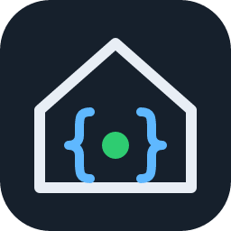

<p align="center">
  
</p>

# SpaceAPI Client for Home Assistant

[](https://hacs.xyz/)
[](https://github.com/dk1sel/ha-spaceapi/actions/workflows/tests.yml)

This custom integration pulls everything a hackerspace publishes via the [SpaceAPI](https://spaceapi.io/)
into Home Assistant: open/closed state, status message, every sensor value (temperature, humidity,
CO₂, power, wind, people present, beverage supply …), contact details, webcams and the location on
the map.

> **Note:** The domain is `spaceapi_client`, deliberately separate from Home Assistant's built-in
> [`spaceapi`](https://www.home-assistant.io/integrations/spaceapi/) integration (which *publishes*
> your own space). Both can be used side by side.

## Installation via HACS (custom repository)

1. Open **HACS** in Home Assistant.
2. Click **⋮ → Custom repositories** (top right).
3. Enter `https://github.com/dk1sel/ha-spaceapi`, choose type **Integration**, click **Add**.
4. Search HACS for **SpaceAPI Client**, open it and click **Download**.
5. **Restart** Home Assistant.
6. **Settings → Devices & services → Add integration → SpaceAPI Client**.

Manual installation: copy `custom_components/spaceapi_client` into Home Assistant's
`config/custom_components/` folder and restart.

## Setup

1. **Search** – type part of the space name (e.g. `chaos`). The official directory
   [directory.spaceapi.io](https://directory.spaceapi.io/) is searched case-insensitively. Or enter
   **your own SpaceAPI URL** directly.
2. **Select** – pick the space from the dropdown; its API URL is filled in automatically.
3. The URL is fetched and validated; the entry is named after the space.

You can add several spaces – each one becomes its own device. **Configure** lets you change the
polling interval (default 5 minutes, minimum 1 minute).

## Entities

| Entity | Content |
|---|---|
| `binary_sensor.<space>_open` | open/closed (`state.open`), attributes `message`, `lastchange`, `trigger_person`; picture = state icon or logo |
| `sensor.<space>_status_message`, `…_last_status_change` | `state.message`, `state.lastchange` (timestamp) |
| Sensors from the `sensors` block | one entity per measurement with matching device class/unit, named after `location`/`name`: temperature, humidity, carbondioxide, barometer, radiation, power_consumption, power_generation, wind, network_connections, network_traffic, account_balance, total_member_count, people_now_present, beverage_supply |
| `binary_sensor.<space>_door_lock_…` | `door_locked` (lock device class: *on* = unlocked) |
| `device_tracker.<space>_location` | location on the map (`location.lat`/`lon`) |
| `camera.<space>_webcam_N` | webcams from `cam`: still image from JPEG/PNG URLs, or the first frame of an MJPEG stream (URLs pointing to web pages show no image) |
| Diagnostic sensors | website (with logo), address, API version, contacts (e-mail, phone, Matrix, Mastodon, IRC, XMPP …), feeds, projects, links, keymasters, last event |

Entity IDs are always English (e.g. `sensor.<space>_temperature_lounge`), whatever language your
instance uses. Friendly names are translated (English and German are included).

Measurements that show up later are added automatically; ones that disappear become unavailable.
If the API cannot be reached, all entities of that space are unavailable until the next successful
update.

## Event `spaceapi_state_changed`

Fired when a space switches between open and closed (never on the first update):

```yaml
event_type: spaceapi_state_changed
data:
  entry_id: "…"
  space: "My Hackspace"
  url: "https://example.org/spaceapi.json"
  open: true
  previous: false
```

Example automation:

```yaml
triggers:
  - trigger: event
    event_type: spaceapi_state_changed
    event_data:
      open: true
actions:
  - action: notify.notify
    data:
      message: "{{ trigger.event.data.space }} is open now!"
```

## Supported API versions

SpaceAPI **v15** and **v14** are fully supported (`api_compatibility`). Older formats (v0.13 with
`api`, v0.12 with `open`/`status`/`icon`/`lat`/`lon` on the top level) are read on a best-effort
basis.

## Diagnostics

**Devices & services → SpaceAPI Client → ⋮ → Download diagnostics** contains the raw API response.

## Development

```bash
pip install -r requirements_test.txt
pytest
```

The tests run on Linux and macOS (and in GitHub Actions); Home Assistant does not support Windows.

## License

MIT – see [LICENSE](LICENSE).
